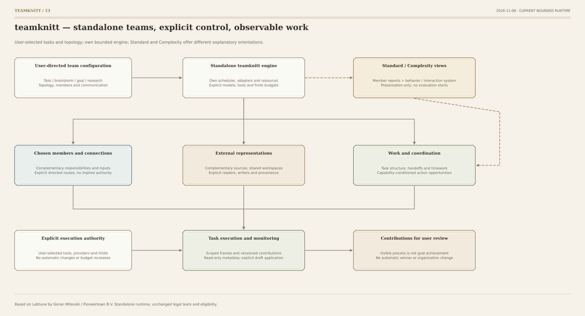
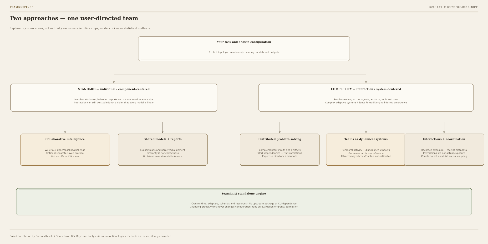

# teamknitt architecture

## A self-contained product and engine

The installable distribution has one namespace and console command: **teamknitt**.
`teamknitt.engine` owns scheduling, provider and decision adapters, persistence, qualified
research tools, structural planning, schemas and engine resources. It imports no upstream
runtime and never delegates execution to another project's CLI or container.

Based on Labtune by Goran Mitevski, Pioneertown B.V. See [provenance](PROVENANCE.md) and the
unchanged LICENSE and LICENSING.md. Source lineage is acknowledged, not concealed by renaming.

## User-directed task execution

`builder.py` mechanically creates schema-3 starter bindings from explicit purpose, member,
topology and sharing choices. `config.py` compiles them into the local engine's task-team
workflow. `runtime.py` extends the shipped scheduler with scoped frames, immutable versioned
notes, route-filtered peer views, wave-barrier publication, handoffs and explicit plan reports.
Models, tools, statistics, delegation and budgets stay user-selected. Generic blockers are
unverified reports, not fabricated measured research failures.

The 14 topology presets are deterministic, support 1–16 members, and restrict both native
peer views and generated artifact exposure. Custom routes are directed. A diagram is not a
claim of causal influence; previous exposure is not erased by later route changes.

The internal `cognition` serialization section and event names remain readable for old
workspaces; the product term is **distributed problem-solving**. Compatibility normalizes
legacy names in memory, never historical files. Raw saved configuration bindings are verified
before display normalization. New identities are not conflated with old execution cohorts.

## Standard and Complexity views

`views.py` projects two approach families over the same configuration/record:

- **Standard:** collaborative intelligence; shared models and member reports.
- **Complexity:** distributed problem-solving; teams as dynamical systems; interactions
  and coordination.

These are explanatory orientations, not exclusive scientific camps or execution presets.
Shared-plan comparisons live under Standard. Complementary information, representations,
work dependencies and handoffs live under distributed problem-solving. Recorded exposure,
cross-level metadata and handoff receipts support the interaction/coordination view.

Optional saved probe evidence is explicitly selected, allowlisted and loaded once. It remains
a separate experiment, never automatically attributed to this roster. Fixture values are not
model evidence; incomplete and ineligible cells remain visible. No official CIB score is added.

`observations.py` supplies optional complexity-science process descriptions: local/global
activity, disturbance response, artifact exposure and cross-level records. Attractors,
synchronization and fractals are not estimated; emergence/adaptation are not inferred.

## Boundaries and migration

The local viewer serves only page/state metadata and non-mutating drafts. Its grouped views
also work offline. Draft application and legacy-name migration are explicit CLI operations,
backed up privately and blocked by the shared run lock. Delayed polls cannot replace newer
user selections/drafts. No browser endpoint starts a model, changes budgets or reads arbitrary
paths. Private contribution text is not exposed in metadata.

Bayesian analysis, prior elicitation, the old package namespace and upstream console script
are not distributed. Unsupported statistical choices fail before provider initialization;
there is no implicit conversion to frequentist analysis. Existing credential variable names
are not rewritten. Changed evaluator source still requires requalification.

Canonical diagrams and topology catalog/schema choices/geometry are in `diagrams/specs.py`.
`tools/sync_starter.py` exports installed resources; the wheel needs no checkout. The source
and artifact release checks reject private paths, stale code and foreign namespaces.

