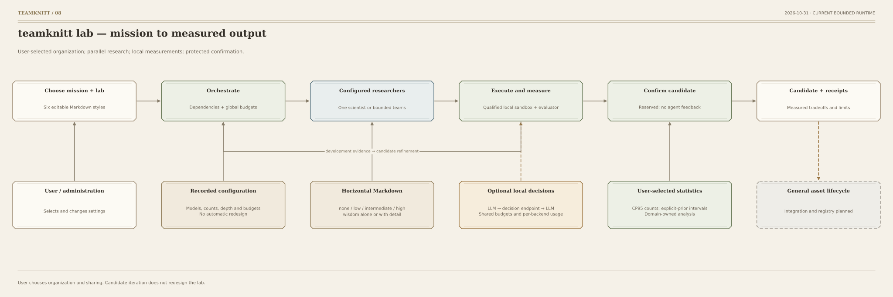
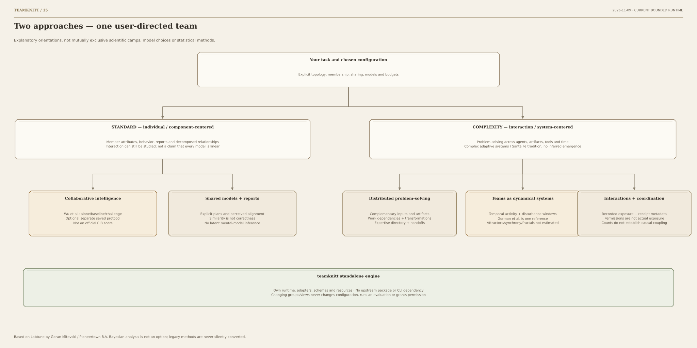

# teamknitt flowcharts

Updated 2026-11-09. These graphs show the implemented bounded study workflow,
memory-policy example and optional local lab observatory. Gray dashed nodes mark planned general asset services.
No graph contains an automatic lab-redesign loop.

Warm ivory, muted mineral colors, serif headings and clipped-corner instrument frames add a
subtle western character. The [display design notes](docs/VISUALIZATION_DESIGN.md) describe
how this treatment carries through to the web monitor while retaining its operational state coding.

Start with the [horizontal overview](HORIZONTAL_LAB_FLOW.md),
[integrated lab](LAB_FLOW.md), or [memory sandbox flow](diagrams/09-memory-policy.svg).

| Graph | Focus | Exports |
|---|---|---|
| Horizontal overview | Mission → teams → measurements → confirmation → output | [SVG](diagrams/08-horizontal-lab.svg) · [PNG](diagrams/08-horizontal-lab.png) · [PDF](diagrams/08-horizontal-lab.pdf) · [Mermaid](diagrams/08-horizontal-lab.mmd) |
| Integrated lab | Designs, parallel teams, bounded children, sharing and local decisions | [SVG](diagrams/06-integrated-lab.svg) · [PNG](diagrams/06-integrated-lab.png) · [PDF](diagrams/06-integrated-lab.pdf) · [Mermaid](diagrams/06-integrated-lab.mmd) |
| Agent-local decision sequence | Same LLM yields, receives a compatible answer, then resumes | [SVG](diagrams/07-agent-decision-loop.svg) · [PNG](diagrams/07-agent-decision-loop.png) · [PDF](diagrams/07-agent-decision-loop.pdf) · [Mermaid](diagrams/07-agent-decision-loop.mmd) |
| Memory-policy execution | Trusted scoring and private inputs versus sandboxed policy source | [SVG](diagrams/09-memory-policy.svg) · [PNG](diagrams/09-memory-policy.png) · [PDF](diagrams/09-memory-policy.pdf) · [Mermaid](diagrams/09-memory-policy.mmd) |
| Single generation agent | One-model baseline with optional specialist decisions | [SVG](diagrams/01-compact-researcher.svg) · [PNG](diagrams/01-compact-researcher.png) · [PDF](diagrams/01-compact-researcher.pdf) · [Mermaid](diagrams/01-compact-researcher.mmd) |
| Parallel teams sharing one model | Contexts, children, ready waves and Markdown barriers | [SVG](diagrams/02-shared-model-mas.svg) · [PNG](diagrams/02-shared-model-mas.png) · [PDF](diagrams/02-shared-model-mas.pdf) · [Mermaid](diagrams/02-shared-model-mas.mmd) |
| Decision backend choices | Configurable chat and typed decision endpoints | [SVG](diagrams/03-optional-decisions.svg) · [PNG](diagrams/03-optional-decisions.png) · [PDF](diagrams/03-optional-decisions.pdf) · [Mermaid](diagrams/03-optional-decisions.mmd) |
| Evidence and confirmation | Candidate refinement with separate calibration and scored cases | [SVG](diagrams/04-scientific-lifecycle.svg) · [PNG](diagrams/04-scientific-lifecycle.png) · [PDF](diagrams/04-scientific-lifecycle.pdf) · [Mermaid](diagrams/04-scientific-lifecycle.mmd) |
| Standalone package | Wheel resources, fresh workspaces and local private panels | [SVG](diagrams/05-standalone-components.svg) · [PNG](diagrams/05-standalone-components.png) · [PDF](diagrams/05-standalone-components.pdf) · [Mermaid](diagrams/05-standalone-components.mmd) |
| Multiple teams | Shared task, independent configurations, explicit routes and total limits | [SVG](diagrams/17-teamknitt-multiple-teams.svg) · [Mermaid](diagrams/17-teamknitt-multiple-teams.mmd) |
| teamknitt research views | Non-system/System locus; separate emergence and process/state axes; six focused views | [SVG](diagrams/15-teamknitt-views.svg) · [Mermaid](diagrams/15-teamknitt-views.mmd) |
| teamknitt intervention | Configure → task → follow → intervene; safe boundaries and explicit human review | [SVG](diagrams/16-teamknitt-intervention.svg) · [Mermaid](diagrams/16-teamknitt-intervention.mmd) |
| Two-agent lab observatory | Selected setup and metadata-only runtime observation in a local web page | [SVG](diagrams/10-lab-observatory.svg) · [PNG](diagrams/10-lab-observatory.png) · [PDF](diagrams/10-lab-observatory.pdf) · [Mermaid](diagrams/10-lab-observatory.mmd) |
| Single scientist | Persistence levels, ordered sequences, shared budgets and one final confirmation | [SVG](diagrams/11-single-scientist.svg) · [PNG](diagrams/11-single-scientist.png) · [PDF](diagrams/11-single-scientist.pdf) · [Mermaid](diagrams/11-single-scientist.mmd) |
| Multiple labs | Separate lab designs, filtered exchange, conference/symposium and selected research sequences | [SVG](diagrams/12-multi-lab.svg) · [PNG](diagrams/12-multi-lab.png) · [PDF](diagrams/12-multi-lab.pdf) · [Mermaid](diagrams/12-multi-lab.mmd) |



Each lab style remains selectable. One configured generation model can fill every role.
The user declares compatible generation and optional decision endpoints and selects LLM-only,
shadow or active routing. No provider, account or model is bundled or automatically selected.

Candidate experimentation can iterate. Configuration is chosen by the user, not evolved by
that feedback. Confirmation does not feed back to acting agents. The memory task fixes policy
source before confirmation and calibrates on a fresh separate event-free panel.

## Regenerate

From the repository root:

```bash
python3 -m pip install -e '.[diagrams]'
python3 diagrams/render_flowcharts.py
```

[specs.py](diagrams/specs.py) is the single source of nodes, edges, text and layout for all
formats. Edit it and regenerate; do not hand-edit generated Mermaid or SVG.
Use --mermaid-only to export Mermaid without image dependencies.
Use --diagram 12-multi-lab to regenerate one specification and update the contact sheet.
The older render_integrated_lab.py and render_horizontal_lab.py commands delegate to the
same renderer. [Overview contact sheet](diagrams/overview.png).


## teamknitt: task teams on the teamknitt engine

The user chooses purpose, member count, topology and communication. Distributed problem-solving
organizes work across members and artifacts; complexity/dynamics dimensions are optional
observation tools. teamknitt is the bounded execution engine and aesthetic foundation.

- [13 · user task, team configuration, engine and observation](diagrams/13-teamknitt-system.svg)
- [14 · brief to observable contributions and user review](diagrams/14-teamknitt-protocol.svg)

Each also has Mermaid, PNG and PDF exports from the same `diagrams/specs.py` definition.
Runtime topology positions for every supported topology and 1–16 members are likewise
defined in `team_topology_layout` in that file and exported by `tools/sync_starter.py`.
The installed viewer uses those packaged positions; no development checkout is needed.

```bash
python diagrams/render_flowcharts.py --diagram 13-teamknitt-system --diagram 14-teamknitt-protocol
```


## Grouped team views and standalone engine



Standard groups collaborative intelligence and shared-model/member reports. Complexity groups
distributed problem-solving, teams as dynamical systems, and interaction/coordination. These
are explanatory orientations, not statistical methods or automatic execution choices. The
engine is self-contained; provenance acknowledges Labtune without an upstream dependency.

All diagrams, labels and routing geometry originate in `diagrams/specs.py`. Regenerate with
`python diagrams/render_flowcharts.py`, then synchronize resources with `tools/sync_starter.py`.
