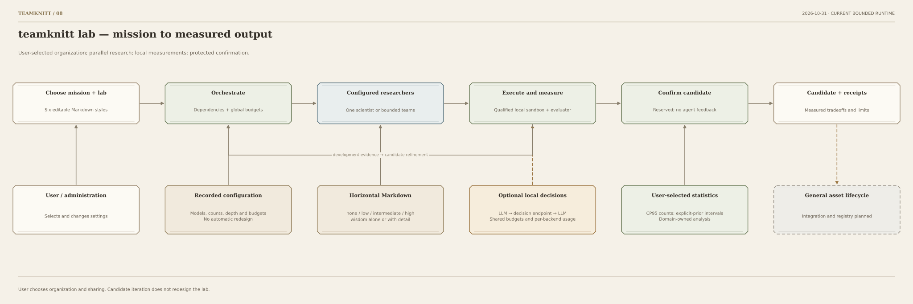

# teamknitt — horizontal lab flow

Updated 2026-10-28. Current bounded runner and domain execution; general asset integration
and registry remain planned. Settings stay user-selected.

[SVG](diagrams/08-horizontal-lab.svg) · [PNG](diagrams/08-horizontal-lab.png) ·
[PDF](diagrams/08-horizontal-lab.pdf) · [Mermaid](diagrams/08-horizontal-lab.mmd)

Read left to right: select mission and lab → orchestrate dependency-ready work → parallel prime
teams and bounded children → qualified experiments → reserved candidate confirmation → source,
measurements and limits. Development feedback refines candidate solutions. It never changes
the user's organization automatically.

The support row records configuration, recipient-filtered Markdown and wisdom, optional
agent-local decisions, and the user's statistical choice. Every generation role can use one
LLM. Compatible chat and typed decision endpoints are configurable. External administration
is separate from research generation.

Sharing levels and wisdom remain independently selectable. Snapshots document past choices;
the user can edit settings for the next run. Live mid-run reconfiguration is not implemented.
A finite-horizon smoke check does not establish novelty, alarm-rate control or a winning style.

See [integrated graph](LAB_FLOW.md), [memory execution](diagrams/09-memory-policy.svg),
and [scope](docs/SKELETON.md). Regenerate all formats from diagrams/specs.py with
python3 diagrams/render_flowcharts.py.
