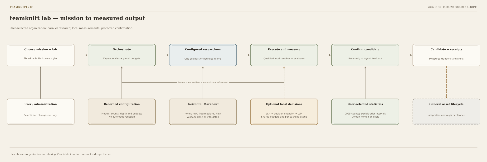

# Labtune <> configurable probablistic discovery labs

De-siloing can create groupthink, while silos can prevent knowledge sharing and reduce
research efficiency.

Labtune tackles the problem of research and lab design when probabilistic research
based on LLMs and decision models is used. The goal is to help researchers reach better
findings by experimenting with lab designs, communication rules and ways of sharing knowledge.

Choose a lab design, configure its communication rules, or connect multiple labs with
different organizational structures and different levels of information sharing.
Labtune lets you experiment with how research is organized, how agents communicate,
and how knowledge moves through a discovery process.

Labtune runs bounded research workflows with a user-selected organization, models,
communication rules and budgets. Choose to run the lab with one scientist agent or several
complementary agents acting as scientists, or even set up and combine different labs with
different communication modes. Inspect the process, and save findings with the available
supporting records, including data sources, experiment results, statistical checks and run
settings. These records help others judge which conclusions are supported and which still
need testing.

**Author:** Goran Mitevski. **Copyright holder and licensor:** Pioneertown B.V.

## Start without a model account

Python 3.11+ is required. From the repository root:

```bash
python3 -m pip install -e .
labtune init ../my-lab
cd ../my-lab
python3 lab.py prepare
```

Setup and planning make no provider calls. Starters contain placeholder URLs and model IDs;
choose your service and credentials explicitly in study.yaml before a live run.
[Getting started](docs/GETTING_STARTED.md) and [provider configuration](docs/PROVIDERS.md)
explain the generation and optional decision protocols. No service account is bundled or preferred.
See [0.5.0 release notes](docs/RELEASE.md) and the [migration guide](docs/MIGRATION.md)
when updating an existing workspace.

## Choose the lab

| Design | Organization |
|---|---|
| A | Multidisciplinary silos |
| B | Transdisciplinary integration |
| C | Complementary co-leaders |
| D | Hub-and-spoke matrix |
| E | Flat / holacratic co-lab |
| F | Single scientist |

[Markdown designs](lab_designs/README.md) supply editable personas and phases. The user chooses
counts, delegation, concurrency, sharing and statistical methods. There is no automated lab redesign.

The [single scientist](docs/SINGLE_SCIENTIST.md) supports low, medium and persistent effort:
1, 3 or 6 passes per sequence, or persistent work until a budget allowance. Choose the sequence
count; sequences continue the same context by default and share one overall budget.

```bash
labtune init ../scientist-lab --template scientist
```

The optional [multi-lab layer](docs/MULTI_LAB.md) runs labs with the same or different
designs. Choose inter-lab sharing from none through detailed findings or wisdom,
hold a conference or symposium, and continue for a selected number of sequences.
Each lab retains its own context and evidence; group and per-lab budgets apply.

```bash
labtune init ../my-labs --template multi-lab
cd ../my-labs
python3 lab.py prepare --multi-lab
python3 lab.py visualize --multi-lab
```

To add more labs, extend `multi_lab.labs` in `study.yaml` with a unique `id` and a
configured `variant` for each lab (2–32 labs). Reuse a variant for the same design,
or select another variant for a different design.

Choose `multi_lab.communication.profile`: `none`, `low`, `intermediate`, `high` or
`wisdom_only`. The `wisdom` setting adds conditional lessons to a detail profile;
use `none` with `wisdom: false` for complete isolation. This inter-lab policy applies
to the whole collection. Each variant separately controls communication among its
own agents.

## Watch the process

Run python3 lab.py visualize --variant single in a text workspace and open its printed local URL.
A setup visualizer and runtime observer show the selected process and current computation.
These local, read-only agents make no model calls. The interface supports saved runs, offline
HTML snapshots, Team view, zoom and node inspection. [Visualization guide](docs/VISUALIZATION.md).



## Execute a measured example

The [synthetic memory-retention task](examples/memory_retention/README.md) includes an independent
generator, bounded policy API, trusted evaluator and separate development/confirmation panels.
Candidate execution requires native macOS sandbox qualification. Text workflows produce
unevaluated proposals; they do not establish scientific correctness.

```bash
python3 -m pip install -e '.[memory]'
labtune init ../memory-lab --template memory
```

One generation model can fill every role. Optional decisions use the same model or a separate
configured endpoint, with LLM-only, shadow and selected-active modes. Other API protocols need
an adapter; changing a URL alone does not translate a protocol. [Decision configuration](docs/DECISION_PROVIDERS.md).

## Scope and evidence

Bayesian binomial analyses can use [model-assisted prior elicitation](docs/BAYESIAN_PRIORS.md):
explicit candidate distributions, an evidence ledger that checks known overlap with likelihood
data, independent predictive checks, user review before adoption, and posterior sensitivity
across alternatives. A decision model's suggestion is a proposal; its confidence never sets
prior strength. This executable option currently supports the memory adapter's primary run rates.

The runner implements dependency-wave scheduling, bounded child agents, filtered Markdown
sharing, provider accounting and registered domain tools. General asset integration, durable
scheduler recovery, live reconfiguration and unrestricted candidate execution remain outside
this release. No benchmark winner or automatic quality improvement is claimed.

See [architecture](ARCHITECTURE.md), [current scope](docs/SKELETON.md), [flow diagrams](FLOWCHARTS.md),
[execution boundaries](SECURITY.md) and [contributing](CONTRIBUTING.md).

Labtune is free to use, modify and share for **noncommercial academic research at qualifying
public or nonprofit educational institutions in World Bank low-income or lower-middle-income
economies** under the [Labtune Academic Research License 2.0](LICENSE).
Company labs, corporate research proxies and commissioned commercial research are excluded.
Company support is allowed only as a genuinely unrestricted donation without control or privileged
research or IP rights. Institutions in upper-middle-income or high-income economies, and other
ineligible users or activities, require separate written permission before use. Contact
Goran Mitevski at [goran@pioneertown.ai](mailto:goran@pioneertown.ai). See [licensing](LICENSING.md).
