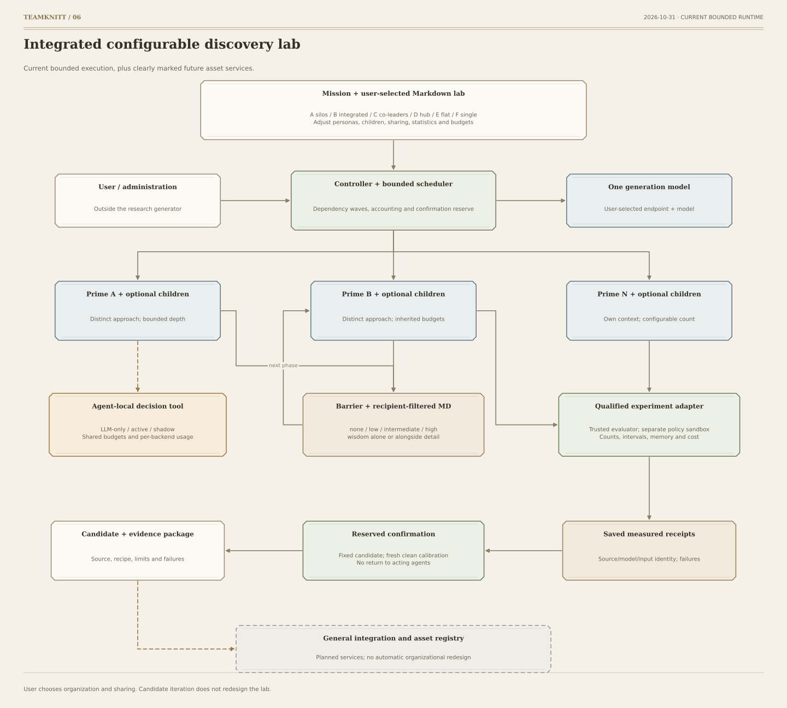

# teamknitt — integrated lab flow

Updated 2026-10-28. This graph shows the current bounded runtime; the general integration
and asset-registry node is marked planned.

[SVG](diagrams/06-integrated-lab.svg) · [PNG](diagrams/06-integrated-lab.png) ·
[PDF](diagrams/06-integrated-lab.pdf) · [Mermaid](diagrams/06-integrated-lab.mmd)

The user selects a Markdown lab preset, personas, children, sharing, statistics and budgets.
The controller schedules dependency-ready waves, accounts for resources and reserves any
declared confirmation. Teams have separate contexts and distinct approaches; children inherit
bounds. One configured generation model can serve every role.

Horizontal Markdown is published after a phase barrier, with recipient limits: none, notable
dead ends at low detail, compact findings at intermediate, detailed permitted artifacts at
high, and conditional abstractions at wisdom-only. Wisdom can accompany low/intermediate/high.
Meetings and handoffs obey the same sharing limit.

An agent can yield to decision.assess, receive a typed answer from the configured backend
and resume the same episode. Compatible chat and typed JSON decision endpoints are configurable;
each user chooses their own service, model and account.
Shadow specialist results stay hidden from acting agents. Other ready tasks can continue.

Qualified domain adapters measure experiments and produce actual receipts. The memory example
runs authored retention source in a separate OS sandbox, keeping labels and future data with
the trusted evaluator. It reports independent-run counts, CP95 intervals and optional
explicit-prior Bayesian summaries. Its final policy is fixed before separate confirmation
calibration and scored confirmation cases; none return to acting agents.

The current output is a candidate with evidence, failures, costs and limits. A general asset
integration/registry service remains planned. User-run repeated comparisons may inform future
choices; there is no automatic lab-redesign, configuration freeze or style-winner loop.
See [horizontal graph](HORIZONTAL_LAB_FLOW.md) and [setup](docs/GETTING_STARTED.md).
